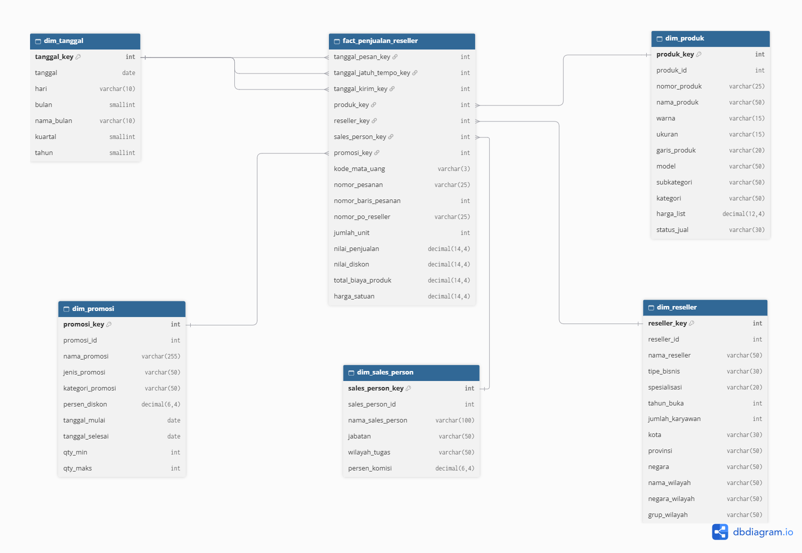

# Desain Star Schema v1: Penjualan Reseller

Kelompok : 7
Versi    : 1 (usulan pekan 9, untuk Steering Review pekan 10)
Diagram  : `docs/star-schema-v1.png` (versi yang bisa diedit: `docs/star-schema-v1.dbml`, tempel ke dbdiagram.io)

## Langkah 1. Proses bisnis

**Penjualan Reseller**: penjualan Adventure Works ke toko (reseller) yang dibuat oleh sales person.
Di sumber, pesanan ini ditandai `sales_salesorderheader.OnlineOrderFlag = 0`.

## Langkah 2. Grain

> Satu baris di `fact_penjualan_reseller` mewakili satu baris pesanan reseller, yaitu satu produk dalam satu pesanan penjualan (`sales_salesorderdetail`) yang dibuat sales person untuk sebuah toko reseller.

Alasan memilih grain ini:

- 
- Grain per pesanan akan menghilangkan analisis per produk dan promosi (promosi dicatat per baris).

Calon jumlah baris fakta: **60.919** (hasil `sql/profil-data-sumber.sql` bagian 3).

## Langkah 3. Dimensi

| Dimensi | Status di bus matrix | Sumber | Diambil dari kolom fakta |
|---------|----------------------|--------|--------------------------|
| `dim_tanggal` | Conformed (semua proses). Struktur standar dari sponsor | dihasilkan, bukan dari tabel sumber | `OrderDate`, `DueDate`, `ShipDate` (role-playing, 3 FK) |
| `dim_produk` | Conformed (5 proses) | `production_product`, `production_productsubcategory`, `production_productcategory`, `production_productmodel` | `sales_salesorderdetail.ProductID` |
| `dim_reseller` | Khusus proses ini | `sales_store`, alamat Main Office (`person_businessentityaddress`, `person_address`, `person_stateprovince`, `person_countryregion`), XML di `sales_store.Demographics` | `sales_salesorderheader.CustomerID` → `sales_customer.StoreID` |
| `dim_sales_person` | Conformed dengan Kinerja Sales | `sales_salesperson`, `person_person`, `humanresources_employee`, `sales_salesterritory` | `sales_salesorderheader.SalesPersonID` |
| `dim_wilayah` | Conformed (4 proses) | `sales_salesterritory`, `person_countryregion` | `sales_salesorderheader.TerritoryID` |
| `dim_promosi` | Conformed dengan Penjualan Online | `sales_specialoffer` | `sales_salesorderdetail.SpecialOfferID` |
| `dim_mata_uang` | Conformed dengan Penjualan Online | `sales_currency` | `sales_salesorderheader.CurrencyRateID` → `sales_currencyrate.ToCurrencyCode` (NULL = USD) |
| `dim_metode_kirim` | Conformed (3 proses) | `purchasing_shipmethod` | `sales_salesorderheader.ShipMethodID` |

### Dimensi yang sengaja tidak dipakai

| Kandidat | Alasan |
|----------|--------|
| Pelanggan | Pembeli di proses ini adalah toko, bukan perorangan. Dipakai `dim_reseller`. |
| Alasan Scrap | Milik proses produksi. |
| Vendor | Milik proses pembelian. |

## Langkah 4. Fakta

| Kolom fakta | Jenis | Rumus dari sumber |
|-------------|-------|-------------------|
| `jumlah_unit` | Aditif | `OrderQty` |
| `nilai_penjualan` | Aditif | `OrderQty * UnitPrice * (1 - UnitPriceDiscount)` |
| `nilai_diskon` | Aditif | `OrderQty * UnitPrice * UnitPriceDiscount` |
| `total_biaya_produk` | Aditif | `OrderQty * biaya standar yang berlaku pada OrderDate` (dari `production_productcosthistory`, cadangan `production_product.StandardCost`) |
| `harga_satuan` | Non-aditif | `UnitPrice`. Tidak dijumlahkan, ditampilkan sebagai rata-rata |

Dimensi degeneratif (disimpan di fakta, tanpa tabel dimensi):

| Kolom | Sumber | Kegunaan |
|-------|--------|----------|
| `nomor_pesanan` | `sales_salesorderheader.SalesOrderNumber` | Menghitung jumlah pesanan, menelusuri ke sumber |
| `nomor_baris_pesanan` | `sales_salesorderdetail.SalesOrderDetailID` | Kunci unik baris fakta bersama `nomor_pesanan`, mencegah data ganda saat ETL diulang |
| `nomor_po_reseller` | `sales_salesorderheader.PurchaseOrderNumber` | Nomor PO dari toko, untuk penelusuran |

### Fakta yang sengaja tidak disimpan

| Kandidat | Alasan |
|----------|--------|
| Persentase margin | Non-aditif. Dihitung dari `nilai_penjualan` dan `total_biaya_produk` saat ditampilkan. |
| Target penjualan sales person | Grain berbeda (per kuartal). Milik proses Kinerja Sales vs Target. |
| Nama toko | Atribut deskriptif, tempatnya di `dim_reseller`. |
| Ongkos kirim (`Freight`) dan pajak (`TaxAmt`) | Dicatat per pesanan, bukan per baris. Kalau dibutuhkan, harus dialokasikan ke baris. Kami usulkan di luar lingkup v1 (lihat keputusan di laporan pekan 10). |

## Kamus data awal

Semua dimensi punya surrogate key (`..._key`) dan natural key dari sumber (`..._id`). Tipe data final ditetapkan di desain fisik pekan 11.

### `fact_penjualan_reseller`

| Kolom | Keterangan |
|-------|------------|
| `tanggal_pesan_key` | FK ke `dim_tanggal`, dari `OrderDate` (dibaca dengan zona waktu sesi +05:30) |
| `tanggal_jatuh_tempo_key` | FK ke `dim_tanggal`, dari `DueDate` |
| `tanggal_kirim_key` | FK ke `dim_tanggal`, dari `ShipDate` |
| `produk_key` | FK ke `dim_produk` |
| `reseller_key` | FK ke `dim_reseller` |
| `sales_person_key` | FK ke `dim_sales_person`, dari sales person di **header pesanan** |
| `wilayah_key` | FK ke `dim_wilayah`, dari wilayah di **header pesanan** |
| `promosi_key` | FK ke `dim_promosi` |
| `mata_uang_key` | FK ke `dim_mata_uang` |
| `metode_key` | FK ke `dim_metode_kirim` |
| `nomor_pesanan`, `nomor_baris_pesanan`, `nomor_po_reseller` | Dimensi degeneratif |
| `jumlah_unit`, `nilai_penjualan`, `nilai_diskon`, `total_biaya_produk`, `harga_satuan` | Fakta (lihat Langkah 4) |

### `dim_reseller`

| Kolom | Sumber |
|-------|--------|
| `reseller_key` | Surrogate key |
| `reseller_id` | `sales_store.BusinessEntityID` |
| `nama_reseller` | `sales_store.Name` |
| `tipe_bisnis` | XML `Demographics` → `BusinessType`: BM = Value Added Reseller, BS = Specialty Bike Shop, OS = Warehouse |
| `spesialisasi` | XML `Demographics` → `Specialty` |
| `tahun_buka` | XML `Demographics` → `YearOpened` |
| `jumlah_karyawan` | XML `Demographics` → `NumberEmployees` |
| `kota`, `provinsi`, `negara` | Alamat bertipe Main Office |

### `dim_sales_person`

| Kolom | Sumber |
|-------|--------|
| `sales_person_key` | Surrogate key |
| `sales_person_id` | `sales_salesperson.BusinessEntityID` |
| `nama_sales_person` | `person_person.FirstName` + `LastName` |
| `jabatan` | `humanresources_employee.JobTitle` |
| `wilayah_tugas` | `sales_salesterritory.Name` lewat `sales_salesperson.TerritoryID` (manajer tidak punya wilayah → "Tidak ada wilayah") |
| `persen_komisi` | `sales_salesperson.CommissionPct` |

### `dim_produk`, `dim_wilayah`, `dim_promosi`, `dim_mata_uang`, `dim_metode_kirim`, `dim_tanggal`

Kolom sesuai diagram. Karena conformed, struktur final `dim_produk` dan `dim_tanggal` mengikuti kesepakatan kelas di pekan 10. Usulan kami untuk `dim_produk`: `produk_id`, `nomor_produk`, `nama_produk`, `warna`, `ukuran`, `garis_produk`, `model`, `subkategori`, `kategori`, `harga_list`, `status_jual`.

## Aturan awal untuk ETL (dari hasil profil data)

1. **Sales person dan wilayah diambil dari header pesanan**, bukan dari toko. 1.563 dari 3.806 pesanan (41%) punya sales person berbeda dengan sales person toko saat ini.
2. **Biaya produk memakai biaya historis** dari `production_productcosthistory` sesuai `OrderDate`. 14.387 baris punya biaya berbeda dengan biaya terbaru. 64 baris tidak punya periode biaya yang cocok, untuk baris ini dipakai `production_product.StandardCost` (sudah dicek sama dengan biaya periode terakhir).
3. **Alamat reseller memakai alamat Main Office.** 11 toko punya dua alamat (Main Office dan Shipping).
4. **Baris "Tidak diketahui"** disiapkan di setiap dimensi dengan key −1. Untuk penjualan reseller, profil menunjukkan tidak ada NULL di sales person, wilayah, toko, dan tanggal kirim, tetapi baris ini tetap disiapkan untuk data baru.
5. **Atribut kosong diisi label**: warna kosong (28 produk) dan ukuran kosong (58 produk) diisi "Tidak ada".
6. **Mata uang**: `CurrencyRateID` NULL berarti USD.
7. **Zona waktu sesi +05:30** di setiap koneksi ke database sumber (`SET time_zone = '+05:30'`), supaya `OrderDate` terbaca sesuai data asli. Alasannya di `docs/sumber-data.md` bagian 3.

## Kandidat SCD (diputuskan di pekan 10)

| Dimensi | Atribut yang berubah | Usulan |
|---------|----------------------|--------|
| `dim_sales_person` | `wilayah_tugas`. Tiga sales person pindah wilayah (Michael Blythe, Jillian Carson, José Saraiva) | Tipe 2, sumber riwayat `sales_salesterritoryhistory` |
| `dim_produk` | `harga_list`, `status_jual` | Tipe 1 untuk v1, menunggu kesepakatan conformed |
| `dim_reseller` | nama, alamat | Tipe 1 |
