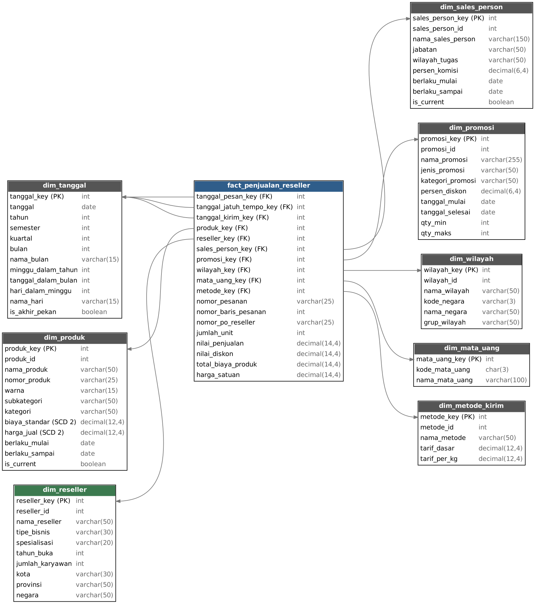

# Dokumentasi Reverse Engineering ERD & Perbandingan Star Schema v2

**Penyusun:** Chandra Febryan Saputra (OLAP Developer)  
**Database:** `dw_kelompok_7`  
**Referensi Desain:** `star-schema-v2.png`  
**Hasil Reverse Engineering:** `dw_kelompok_7_.png` (DBeaver Community Edition)  

---

## 1. Perbandingan Visual ERD

### A. Rancangan Star Schema v2 (`star-schema-v2.png`)

### B. Hasil Reverse Engineering Database (`dw_kelompok_7.png`)

---

## 2. Tabel Perbandingan Struktur & Atribut

Pengecekan dilakukan dengan membandingkan setiap entitas, tipe data ikon DBeaver (`123` numerik, `A-Z` string, ikon jam `date/datetime`), penetapan *Primary Key*, serta jumlah garis relasi *Foreign Key* antara rancangan v2 dan hasil *reverse engineering* database.

| No | Nama Entitas / Tabel | Spesifikasi Star Schema v2 (`star-schema-v2.png`) | Hasil Reverse Engineering (`img/dw_kelompok_7.png`) | Status |
| :---: | :--- | :--- | :--- | :---: |
| 1 | `dim_tanggal` | 12 kolom (`tanggal_key` PK, `tanggal`, `tahun`, `semester`, `kuartal`, `bulan`, `nama_bulan`, `minggu_dalam_tahun`, `tanggal_dalam_bulan`, `hari_dalam_minggu`, `nama_hari`, `is_akhir_pekan`) | 12 kolom dengan nama, urutan, PK (`tanggal_key`), dan tipe data identik | Sesuai |
| 2 | `dim_produk` | 12 kolom (`produk_key` PK, `produk_id`, `nama_produk`, `nomor_produk`, `warna`, `subkategori`, `kategori`, `biaya_standar`, `harga_jual`, + SCD Type 2: `berlaku_mulai`, `berlaku_sampai`, `is_current`) | 12 kolom dengan nama, urutan, PK (`produk_key`), dan 3 atribut SCD Type 2 identik | Sesuai |
| 3 | `dim_sales_person` | 9 kolom (`sales_person_key` PK, `sales_person_id`, `nama_sales_person`, `jabatan`, `wilayah_tugas`, `persen_komisi`, + SCD Type 2: `berlaku_mulai`, `berlaku_sampai`, `is_current`) | 9 kolom dengan nama, urutan, PK (`sales_person_key`), dan 3 atribut SCD Type 2 identik | Sesuai |
| 4 | `dim_reseller` | 10 kolom (`reseller_key` PK, `reseller_id`, `nama_reseller`, `tipe_bisnis`, `spesialisasi`, `tahun_buka`, `jumlah_karyawan`, `kota`, `provinsi`, `negara`) | 10 kolom dengan nama, urutan, PK (`reseller_key`), dan tipe data identik | Sesuai |
| 5 | `dim_promosi` | 10 kolom (`promosi_key` PK, `promosi_id`, `nama_promosi`, `jenis_promosi`, `kategori_promosi`, `persen_diskon`, `tanggal_mulai`, `tanggal_selesai`, `qty_min`, `qty_maks`) | 10 kolom dengan nama, urutan, PK (`promosi_key`), dan tipe data identik | Sesuai |
| 6 | `dim_metode_kirim` | 5 kolom (`metode_key` PK, `metode_id`, `nama_metode`, `tarif_dasar`, `tarif_per_lb`) | 5 kolom dengan nama, urutan, PK (`metode_key`), dan tipe data identik | Sesuai |
| 7 | `dim_mata_uang` | 3 kolom (`mata_uang_key` PK, `kode_mata_uang`, `nama_mata_uang`) | 3 kolom dengan nama, urutan, PK (`mata_uang_key`), dan tipe data identik | Sesuai |
| 8 | `dim_wilayah` | 6 kolom (`wilayah_key` PK, `wilayah_id`, `nama_wilayah`, `kode_negara`, `nama_negara`, `grup_wilayah`) | 6 kolom dengan nama, urutan, PK (`wilayah_key`), dan tipe data identik | Sesuai |
| 9 | `fact_penjualan_reseller` | 18 kolom (Composite PK: `nomor_pesanan`, `nomor_baris_pesanan`; degenerate dimension: `nomor_po_reseller`; 10 FK; 5 measures: `jumlah_unit`, `nilai_penjualan`, `nilai_diskon`, `total_biaya_produk`, `harga_satuan`) | 18 kolom dengan Composite PK, 10 FK, dan 5 measures identik | Sesuai |

---

## 3. Verifikasi Integritas Relasi (Foreign Key)

Total terdapat **10 garis relasi** dari tabel fakta `fact_penjualan_reseller` menuju 8 tabel dimensi pada kedua diagram:
1. **`dim_tanggal` (3 relasi *Role-Playing Dimension*):** Terhubung melalui `tanggal_pesan_key`, `tanggal_jatuh_tempo_key`, dan `tanggal_kirim_key`.
2. **`dim_produk` (1 relasi):** Terhubung melalui `produk_key`.
3. **`dim_reseller` (1 relasi):** Terhubung melalui `reseller_key`.
4. **`dim_sales_person` (1 relasi):** Terhubung melalui `sales_person_key`.
5. **`dim_promosi` (1 relasi):** Terhubung melalui `promosi_key`.
6. **`dim_wilayah` (1 relasi):** Terhubung melalui `wilayah_key`.
7. **`dim_mata_uang` (1 relasi):** Terhubung melalui `mata_uang_key`.
8. **`dim_metode_kirim` (1 relasi):** Terhubung melalui `metode_key`.

---

## 4. Kesimpulan

Berdasarkan perbandingan di atas, implementasi fisik database `dw_kelompok_7` hasil *reverse engineering* (`img/dw_kelompok_7.png`) telah **100% sesuai dengan rancangan Star Schema v2 (`star-schema-v2.png`)** baik dari sisi jumlah entitas, atribut, tipe data, *Primary Key*, maupun relasi *Foreign Key*. Tidak terdapat penyimpangan struktur sehingga tidak diperlukan pengajuan *Change Request*, dan skema siap dilanjutkan ke tahap pengujian data dan pengembangan OLAP.